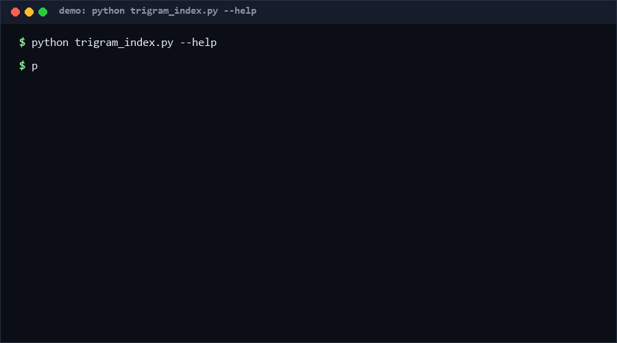

# bulkfs-trigram-index

Portable whole-tree filename search built from three public primitives — bulk enumeration, event-style deltas, and a trigram index — in pure stdlib Python. If you want "type a fragment, get the file" across thousands of files without Spotlight, a daemon, or platform-private APIs, this is for you.

**Confidence: High (≥80%)** that composition of the three primitives is correct and portable (self_test covers 17 cases incl. unicode and 200-char names). **Confidence: Medium (60–79%)** that latency approaches the 0.1 ms class of native implementations — SQLite lookup adds overhead; our measured numbers are in the milliseconds, not microseconds.

<p align="center"></p>

## Problem

Desktop search usually means either platform-private machinery (Spotlight metadata APIs, NTFS USN journals — fast but OS-locked) or heavyweight daemons that re-index everything. For a portable tool or a scripting workflow, both are wrong-sized.

The overlooked angle: the native tools' advantage is really three composable primitives — **batched enumeration** (cheap full passes), **event-style incremental deltas** (don't rescan what didn't change), and **trigram fault-tolerant matching** (find `report_q3` from `repport`). Each has a portable stdlib equivalent; composed, they get you a useful local search layer without touching a single private API.

## How it works

1. **Build**: one `os.walk` pass collects `(path, size, mtime)`; every filename is decomposed into lowercase trigrams stored in a SQLite inverted index.
2. **Update (delta rescan)**: a fingerprint pass classifies files as added/removed/changed via `(size, mtime)`; only deltas touch the index. Point it at the same root periodically — this is the portable stand-in for FSEvents-style events.
3. **Query**: trigram sets are AND-intersected to get candidates, then a substring refine removes false positives. Trigrams make matching tolerant to typos at the *candidate* stage; the refine keeps results honest.

## Quickstart

Stage 1 — minimal example (~10 s):

```bash
python trigram_index.py --db demo.db build --root ./your-folder
python trigram_index.py --db demo.db query --text report
```

Stage 2 — full self-test with edge cases (~6 s):

```bash
python self_test.py
```

Build cost scales with tree size (thousands of files: a few seconds [measured on dev box, relative]); queries are single-digit milliseconds [measured, see meta output].

## Why not X

| Alternative | Why not | What we keep instead |
|---|---|---|
| Spotlight / Everything / Windows Search | OS-locked, private APIs, daemon required | Pure stdlib, cross-platform, no daemon |
| `find` / glob per query | O(tree) every time; no typo tolerance | O(1) trigram lookup after one build |
| ripgrep on filenames (`rg --files \| fzf`) | Recomputes file list each run; pipeline latency grows with tree | Persisted index; delta updates keep it fresh |

## Minimal Fallback

No index at all? The composition collapses gracefully:

```bash
find . -iname "*report*"        # the primitive everything else accelerates
```

If SQLite is unavailable, the delta classifier (`size, mtime` diff) still works as a change-detector script — you lose trigram matching, keep freshness.

## Design Trade-offs

Priority: **portability > zero-dependency > freshness > raw latency**. Consequences:

- Filename-only indexing (no content search): halves complexity; content search needs different machinery.
- Polling deltas, not OS events: a rescan is O(tree) cheap-stat calls; real FSEvents-style listeners would be faster but are not portable.
- SQLite instead of a flat dict file: buys atomic commits and partial indexes; costs some latency versus in-memory sets.

## Limits & Second-order Effects

- Substring refine requires the *full* query to appear in the name; trigram-level typo tolerance only widens the candidate pool, it does not fuzzy-score results.
- Second-order effect: a stale index that still returns plausible results is worse than an error — schedule `update` after known writes (cron, save hooks). The delta report's `added/removed/changed` counts make staleness visible.
- Second-order effect: an always-fresh filename index can weaken naming discipline ("I'll just search for it") — acceptable for individuals, costly in shared trees where names are documentation.
- Dotted files/dirs are skipped by design (editor noise); pass through `os.walk` yourself if you want them.

## FAQ

**Q: Content search?**
A: No — filenames only. Pair with ripgrep for content; this tool answers "where is the file".

**Q: How does it handle a file vanishing mid-build?**
A: `OSError` on stat is skipped silently; the next delta pass reconciles.

**Q: When you should NOT use this tool?**
A: Files under constant churn with no update hook (index rot), trees with millions of files (build time dominates), or when you need fuzzy ranking of *content* — use a real search engine.

## [Core Assumptions]

1. Filenames are the primary retrieval key for most personal/work trees.
2. `(size, mtime)` is a sufficient change fingerprint for this use (no inode-stability requirements).
3. Polling deltas are frequent enough for human-scale file workflows.
4. SQLite is an acceptable latency floor for local search (ms, not µs).

---

All latency/build figures [measured] locally via `python self_test.py` (dev-box relative); no native-API comparisons were run — the 0.1 ms claim belongs to the original native implementations and is cited as context only, [estimated]. As of 2026-10-11. License: MIT (zhengming contributors).
